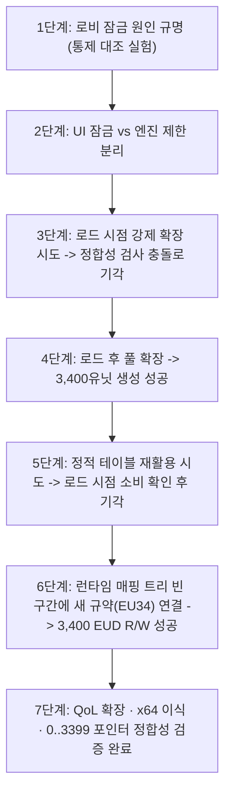

# StarCraft: Remastered EUD 3400 유닛 확장 연구 기록

StarCraft: Remastered(SC:R) 환경에서 **EUD(Extended Unit Deaths) 맵이 1,700유닛 상한(Original)으로 고정되는 원인**을 실험적으로 규명하고, 기존 1.16.1 주소 공간과 충돌하지 않는 **새 EUD 확장 규약(`EU34`)**으로 3,400유닛(Extended) 동등 기능(Native Parity)을 달성할 수 있는지 검증한 **방법론·시행착오·아키텍처 연구 기록**입니다.

> **공개 범위 안내**
> 이 문서 모음은 기술적 원인 분석, 가설 검증 절차(통제 실험 및 반증 과정), 그리고 맵 제작자 관점의 주소 규약 설계 개념만을 다룹니다. 온라인 환경에서의 오남용을 방지하기 위해 **실행 가능한 패치 도구, 클라이언트 바이너리 오프셋/RVA, 메모리 조작 코드 등은 의도적으로 제외**했습니다. 모든 검증은 오프라인 로컬 싱글플레이 환경에서만 수행되었습니다.

---

## 핵심 요약

1. **로비 잠금의 원인은 맵 구조가 아니라 EUD 서명이다.**
   - 파일 크기, 트리거 개수, 일반 `Deaths`/`SetDeaths` 트리거를 통제한 대조 실험으로, 로비의 `Unit Limits` 비활성화 키가 EUD 확장 서명임을 확인했다.
2. **로비 UI 해제만으로는 3,400유닛이 동작하지 않는다.**
   - UI 잠금을 풀더라도 엔진 내부의 EUD 맵 판정과 로드 시점 정합성 검사 때문에 실제 게임은 1,700유닛으로 제한되거나 로드 단계에서 중단된다.
3. **기존 1.16.1 EUD 유닛 테이블의 제자리(in-place) 확장은 구조적으로 불가능하다.**
   - 1,700번째 슬롯 직후부터 게임 전역 상태와 다른 EUD 매핑이 연속 배치되어 있어, 테이블 크기를 두 배로 늘리면 인접 데이터와 충돌한다.
4. **로드 후 풀 확장 + 런타임 매핑 트리 확장으로 x86/x64 모두 개념 증명(PoC)에 성공했다.**
   - Original(1,700)로 정상 로드한 뒤, 미리 확보된 네이티브 풀의 논리 상한을 확장하고, 런타임 EUD 매핑 자료구조의 빈 주소 구간에 새 확장 규약(`EU34`)을 연결하는 방식으로 3,400유닛의 EUD 읽기/쓰기, 확장 유닛 파인더, 아키텍처 자동 분기, 그리고 `0..3399` 포인터 필드 정합성(Parity)까지 검증했다.

---

## 문서 목차

| 문서 | 내용 |
| --- | --- |
| [01. 방법론 및 시행착오 연대기](./01-methodology-and-trials.md) | 통제 실험 설계, 실패한 6가지 가설과 기각 근거, 돌파구를 찾은 과정 전체 정리 |
| [02. 아키텍처 및 `EU34` 규약 개념](./02-architecture-and-abi.md) | 1.16.1 주소 충돌 분석, `0x10000000` 새 주소 창, QoL 메타데이터, `0..3399` 포인터 정규화 모델 |
| [03. ADR: 새 규약 채택 결정 기록](./03-adr-new-convention.md) | 기존 맵 호환 대신 새 규약을 선택한 배경, 대안 비교, Native Parity 기준, 남은 과제 |
| [04. 도메인 용어집](./04-glossary.md) | 연구 전반에서 혼동을 막기 위해 정의한 핵심 용어와 구분 기준 |

---

## 연구 진행 흐름 한눈에 보기

